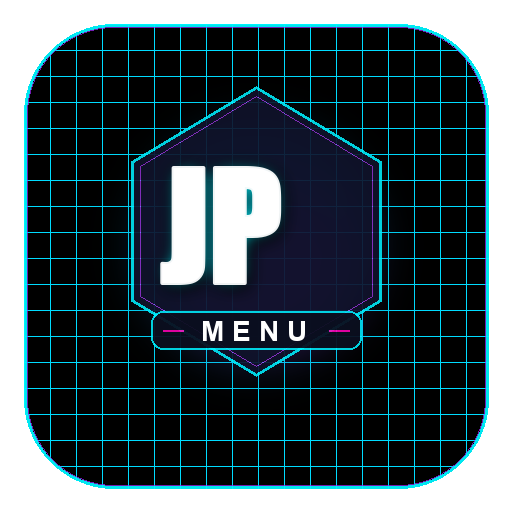

# JPMenu

  

**JPMenu** es el mod menú más completo, optimizado y fluido para **Geometry Dash** en **PC (Windows / Mac) y Android**.

Desarrollado y mantenido por **zPAB**.

---

## 🚀 Características Principales

- **Gameplay & Práctica:**
  - StartPos Switcher con controles flotantes.
  - Visualizador de Hitboxes en tiempo real (normales y circulares).
  - Noclip con medidor de precisión y muertes evitadas.
  - Auto Practice, Checkpoint Fix y reinicio rápido.
- **Rendimiento & Precisión:**
  - Speedhack fluido y personalizable con teclas rápidas.
  - TPS Bypass y optimizaciones de fotogramas.
- **Cosméticos & Visuales:**
  - Solid Wave Trail con colores personalizados.
  - Ocultar efectos de muerte y distracciones visuales.
  - Temas y colores para personalizar la interfaz.
- **Creador & Editor:**
  - Zoom bypass, Slider limit bypass, Verify hack y Copy hack.
- **Multiplataforma:**
  - Soporte completo para pantalla táctil en Android y teclado/ratón en PC.

---

## 🎮 Controles
- **En PC:** Presiona la tecla <cg>Tab</c> para abrir/cerrar el menú.
- **En Móviles (Android / iOS):** Toca el botón flotante en la pantalla.
